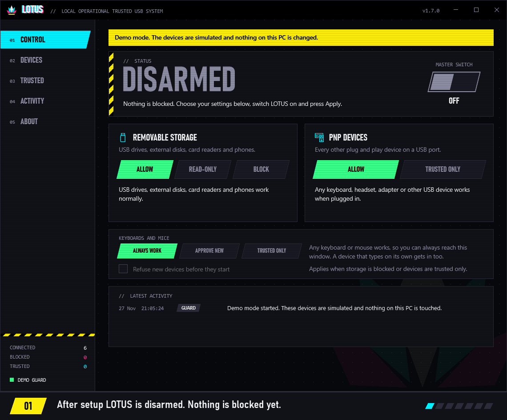
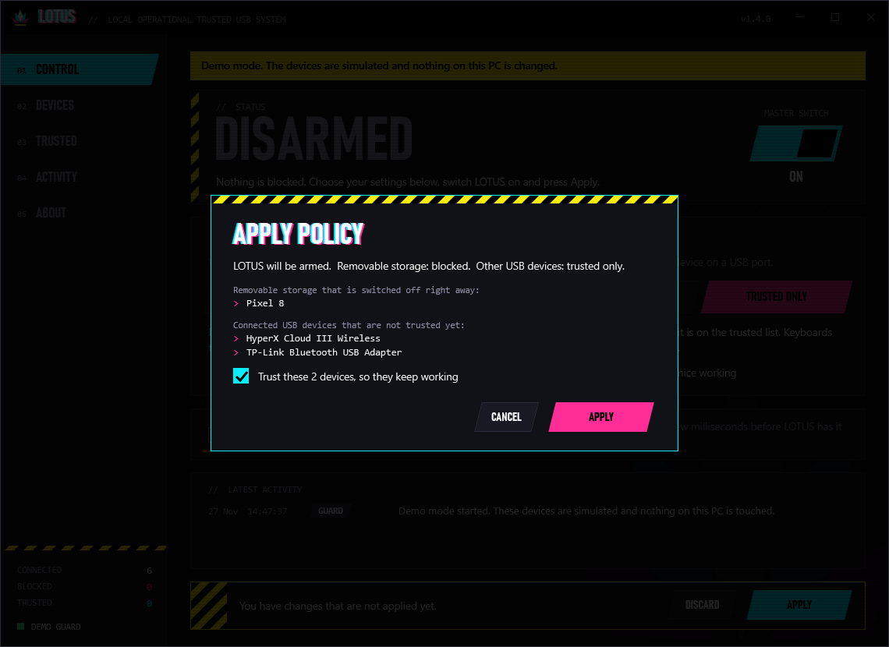

<p align="center">
  
</p>

<p align="center">
  <a href="https://github.com/MAXIVA11/LOTUS/actions/workflows/build.yml"></a>
  <a href="https://github.com/MAXIVA11/LOTUS/releases/latest"></a>
  <a href="LICENSE"></a>
</p>

<p align="center">
  <a href="#install">Install</a> ·
  <a href="#linux">Linux</a> ·
  <a href="#your-first-policy">First policy</a> ·
  <a href="#how-blocking-works">How it works</a> ·
  <a href="#limits">Limits</a> ·
  <a href="#protection">Protection</a> ·
  <a href="#build-from-source">Build</a>
</p>

LOTUS decides which USB devices are allowed to work on a computer. On Windows you pick a policy in the app and a Windows service enforces it. On Linux a daemon enforces it and you set the policy with the `lotus` command.

It controls two things: removable storage, and every other plug and play (PnP) device on a USB port.

Most of this page describes the Windows version. [Linux](#linux) has a section of its own.

<p align="center">
  
</p>


## What you can set

| Setting | Choices | What it covers |
| --- | --- | --- |
| Removable storage | Allow, Read-only, Block | USB drives, external disks, card readers, phones and cameras |
| PnP devices | Allow, Trusted only | Keyboards, mice, headsets, network and Bluetooth adapters, printers, hubs and anything else on USB |
| Trusted list | One device, a whole model or a whole vendor | Devices on the list are never blocked |

A device you trust as "this device" is matched by its serial number. A device you trust as "whole model" is matched by vendor and product ID, so every unit of that model works. A "whole vendor" entry is matched by the vendor ID alone and covers everything that vendor makes.

A new installation starts like this: disarmed, removable storage on Allow, PnP devices on Allow, "Keep keyboards and mice working" ticked, "Refuse new devices before they start" not ticked, and an empty trusted list.

- Setup blocks nothing. LOTUS stays disarmed until you choose a policy and switch it on.
- Before a policy is applied, LOTUS lists the connected devices it would switch off.
- A blocked device stays off after it is replugged, after a restart, and while the service is stopped.
- With "Refuse new devices before they start" ticked, a blocked device this PC has never seen does not start at all: Windows itself refuses to install it.
- The policy and the trusted list sit in an encrypted store that only the LOTUS service can open. Someone who finds the files cannot read them, and a changed file is put back.
- An activity log records every block and release, and a small notifier next to the clock tells whoever is at the PC why the thing they just plugged in does nothing.


## Install

1. Download `LOTUS-Setup.exe` from the [releases page](https://github.com/MAXIVA11/LOTUS/releases), or build it yourself (see [Build from source](#build-from-source)).
2. Run it and accept the Windows administrator prompt.
3. Tick "Trust the USB devices that are connected right now" if you want your own devices on the trusted list from the start. It is not ticked unless you tick it.
4. Press <kbd>Install</kbd>, then <kbd>Open LOTUS</kbd>.

> [!NOTE]
> Nothing is blocked after installation. LOTUS stays disarmed until you choose a policy and switch it on.

The setup file is not code signed, so Windows SmartScreen may show "Windows protected your PC" the first time. Choose More info, then Run anyway. Each release lists the file's SHA-256 hash so you can check your download.

LOTUS runs on Windows 10 (version 1607 or newer) and Windows 11. It uses the .NET Framework 4.6.2 or newer that those versions already include, so there is no runtime to install.

<p align="center">
  
</p>

## Linux

LOTUS for Linux has the same rules, the same decision engine and the same encrypted store. It has no window: a daemon enforces the policy, and you set it in a terminal.

Download `lotus-<version>-linux-x64.tar.gz` from the [releases page](https://github.com/MAXIVA11/LOTUS/releases).

```sh
tar -xzf lotus-*-linux-x64.tar.gz
cd lotus-*-linux-x64
sudo ./install.sh
```

```sh
sudo lotus devices
sudo lotus storage block
sudo lotus arm
```

It needs a 64-bit Intel or AMD computer and a Linux that uses systemd. The program is one file that carries its own runtime.

To block a device, LOTUS uses the switch the kernel has for every USB device, the `authorized` file. A device that is switched off there has no driver and none of its functions. With strict mode switched on (`lotus strict on`), the kernel does not switch on anything that is plugged in until LOTUS has looked at it, so a device the policy blocks never runs.

> [!NOTE]
> The Linux version is tested on Ubuntu 24.04 in a virtual machine, with USB devices that QEMU emulates. The kernel in that test is real and the devices are not. It has not been run against physical USB hardware.

[docs/linux.md](docs/linux.md) has the commands, how blocking works on Linux, the limits and how it is tested.

There is no macOS version. Blocking a USB device on macOS takes entitlements that Apple grants to signed drivers and security products, and this project has no Mac to test on.

## Your first policy

1. Open LOTUS. The status reads DISARMED.
2. Under Removable storage, choose Allow, Read-only or Block.
3. Under PnP devices, choose Allow or Trusted only.
4. Turn the master switch on and press <kbd>Apply</kbd>.

Before anything changes, LOTUS shows which connected devices the new policy would switch off. If you chose Trusted only, it offers to put the devices that are connected right now on the trusted list, so your own headset and adapters keep working.

<p align="center">
  
</p>

To let a blocked device in later, plug it in, open the Devices page and press <kbd>Trust device</kbd> or <kbd>Trust model</kbd>. It starts working within a second or two.

A device that is not plugged in can be trusted by hand on the Trusted page. Choose what you have and type it in:

| Kind | What to type | What it covers |
| --- | --- | --- |
| Vendor | The vendor ID, for example `046D` | Every device that vendor makes |
| Model | Vendor and product ID, for example `046D:C52B` | Every unit of that model |
| Device | The instance path, for example `USB\VID_0781&PID_5567\4C530001230505116353` | That one device |

Device Manager shows these under Details, as "Hardware Ids" and "Device instance path". An entry made by hand covers the device whatever it does, because LOTUS has not seen it. A whole vendor is a wide door: it also lets in devices you have never seen.

<p align="center">
  
</p>

Whoever is at the PC sees this when a device is blocked:

<p align="center">
  
</p>

"Keep keyboards and mice working" is on by default. With it on, any keyboard or mouse works even under Trusted only, so you can always reach LOTUS.

> [!WARNING]
> Turn "Keep keyboards and mice working" off only if you also want to stop devices that pose as keyboards and type on their own. Trust your own keyboard and mouse before you do. If it goes wrong, see [If you lock yourself out](#if-you-lock-yourself-out).


## How blocking works

LOTUS Guard is a Windows service that runs as SYSTEM. Windows tells it as soon as a device appears on a USB port. The service reads what the device is from the device's own descriptors, checks that against the policy, and switches a blocked device off with the same Windows call Device Manager uses for "Disable device".

<p align="center">
  
</p>

Check 05 has two exceptions. A device that Windows reports as built into the computer, such as a laptop webcam, is allowed. So is a device whose only other function is input, as long as "Keep keyboards and mice working" is on.

The disabled state belongs to that device, and Windows remembers it. A blocked drive stays off when it is unplugged and plugged back in, after a restart, and while the service is stopped. Devices this PC has seen before, and that the policy blocks, are marked as disabled while they are unplugged, so they are already off when they come back.

A device this PC has never seen has no record to mark. For those, LOTUS uses the device installation restrictions that are part of Windows: while LOTUS is armed, Windows refuses to install any USB device the policy blocks, so such a device never starts. This is the "Refuse new devices before they start" switch. It is off after installation, and you tick it on the Control page. A new device the policy allows, such as a new keyboard, is let through by LOTUS and works a fraction of a second later.

Sometimes Windows refuses to stop a device because a program has it open, typically Explorer reading a drive that was just plugged in. LOTUS then takes the device off the bus by resetting its USB port, which no program can refuse.

LOTUS keeps a ledger of every device it switched off and only ever re-enables devices on that ledger. A device you disabled yourself in Device Manager stays disabled.

A trusted device is remembered together with what it does. If a trusted headset comes back presenting a keyboard or a disk as well, it is no longer treated as trusted.

Read-only mode works differently. It sets the "Removable Storage Access" policy that is built into Windows, so the storage stack itself refuses the write. LOTUS restarts connected drives for a moment so the change reaches them.

The full description is in [docs/how-it-works.md](docs/how-it-works.md).

## Limits

- Trust is based on what a device reports about itself. A device built to copy the vendor, product, serial number and functions of a trusted device is treated as that device.
- With "Keep keyboards and mice working" on, any device that is only a keyboard or mouse works, including one that types on its own.
- With "Refuse new devices before they start" off, which is how LOTUS starts, or on a Windows older than Windows 10 21H2, a blocked device this PC has never seen runs for a few milliseconds before LOTUS has it switched off.
- A trust entry for a whole vendor, or one typed in by hand, is not tied to what the device does. Any device that reports that vendor, model or path is let in.
- Windows reads the descriptors of every device that is plugged in, blocked or not. A device built to attack the Windows USB drivers through its descriptors is not stopped by LOTUS.
- If the PC already has device installation restrictions from an administrator or from Group Policy, LOTUS leaves them alone and does not add its own.
- LOTUS has no password. Anyone who can run the app as an administrator can change the policy, and an administrator who is determined to remove LOTUS, for example from Safe Mode, can do so.
- LOTUS covers USB ports. It does not manage Bluetooth pairing, Thunderbolt docks, SATA ports or network shares.
- Read-only mode applies to every removable drive, trusted ones included, because Windows applies it to the whole class of device. It also covers CD and DVD writers.
- The disk Windows boots from is never blocked, even when it is a USB disk.

## Protection

The policy and the trusted list are kept in an encrypted store, `C:\ProgramData\LOTUS\secure\policy.dat`. It is a binary file encrypted with AES-256 and authenticated with HMAC-SHA256. The key is random, tied to this PC, and readable by the service account only.

- Nobody else can read the store, administrators included. The app asks LOTUS Guard for the policy and sends each change to it.
- If someone edits, replaces or deletes the store, LOTUS Guard puts its own copy back and writes a "tampering" line to the activity log.
- The service cannot be stopped, reconfigured or deleted with the Windows tools. If its process is killed, Windows starts it again after a second, and blocked devices stay blocked in the meantime.
- If the store is wrecked while the service is not running, LOTUS locks down: it blocks removable storage and untrusted devices until setup is run again.

[docs/security.md](docs/security.md) has the details, the results of the security review of 1.0, and what LOTUS cannot protect against.

## Try it without installing

`LOTUS.exe --demo` opens the app with simulated devices and a simulated guard. Nothing on the PC is changed, and you can plug a pretend flash drive in and out to see blocking and the notification.

## If you lock yourself out

With "Keep keyboards and mice working" turned off, an untrusted keyboard or mouse is blocked like any other device. If you end up with no working input device:

1. Start Windows in Safe Mode. LOTUS Guard does not run there.
2. Use a keyboard LOTUS has not blocked. For most keyboards a different USB port is enough, because a keyboard without a serial number counts as a new device in each port.
3. Open an administrator command prompt and run `"C:\Program Files\LOTUS\LotusGuard.exe" --release-all`. It disarms LOTUS and switches every blocked device back on.
4. Restart, open LOTUS and fix the policy before you arm it again.

## Uninstall

Use "Installed apps" in Windows Settings, or run `"C:\Program Files\LOTUS\Uninstall.exe"`. The uninstaller switches every blocked device back on, lifts read-only mode, takes away the restrictions it set in Windows, and removes the service, the program files, the policy and the log.


## Build from source

For the Windows version you need Windows and the .NET SDK 8 or newer.

```powershell
git clone https://github.com/MAXIVA11/LOTUS.git
```

```powershell
powershell -ExecutionPolicy Bypass -File LOTUS\build.ps1
```

The result is `dist\LOTUS-Setup.exe`. The script builds the app and the service, runs the unit tests, packs both into the setup program and prints its SHA-256 hash.

The Linux version is built on Linux with `./build-linux.sh`, which writes `dist/lotus-<version>-linux-x64.tar.gz`.

| Folder | Contents |
| --- | --- |
| `src/Lotus.Core` | Policy model, the decision engine, the service loop and the encrypted store, which every version shares, and the Windows device calls |
| `src/Lotus.Guard` | `LotusGuard.exe`, the Windows service |
| `src/Lotus.App` | `LOTUS.exe`, the app and the notifier |
| `src/Lotus.Setup` | `LOTUS-Setup.exe`, the installer and uninstaller |
| `src/Lotus.Linux` | `lotus`, the Linux daemon and command |
| `packaging/linux` | The systemd service and the install and uninstall scripts |
| `tests/Lotus.Tests` | Unit tests for the engine, the enforcement loop, the encrypted store, strict mode and the control pipe |
| `tests/Lotus.Linux.Tests` | The same tests against the Linux build, and tests for the Linux parts |
| `tests/Lotus.Probe` | A small developer tool that runs single device calls, used by the hardware scripts |
| `tests/hardware` | Scripts that test device control and a full install on real Windows hardware |
| `tests/linux` | A script that tests a full install on a real Linux kernel in a virtual machine |

## Tests

`dotnet test tests\Lotus.Tests` runs the unit tests. They cover the policy engine, the encrypted store and strict mode, and they run the real service loop against a simulated USB bus and talk to it over a real pipe.

The scripts in `tests\hardware` need an administrator prompt and real devices. `e2e-install.ps1` updates whatever LOTUS is installed, also from 1.0 and 1.1, installs fresh, and then checks on real hardware that one chosen device is blocked and released, that Windows refuses a blocked device it has never seen and lets an allowed one in, that a blocked device stays off when it is plugged in again, that nothing in the store can be read, that the service resists being stopped, and that a changed policy store is put back. It ends by removing LOTUS and checking that nothing is left. Read the comments at the top of each script before running it.

`dotnet test tests/Lotus.Linux.Tests` runs the shared tests against the Linux build, together with tests for the Linux parts on a made-up device tree. `tests/linux/vm-test.sh` boots Ubuntu under QEMU, installs LOTUS and plugs emulated USB devices in and out. [docs/linux.md](docs/linux.md#how-it-is-tested) lists what it checks.

## Disclaimer

LOTUS is provided as it is, without warranty of any kind. It switches devices off, and a policy that is set wrongly can leave you without a working keyboard, mouse or disk. The authors are not responsible for damage, lost data, lost access or any other harm that comes from installing or using it. Try a policy on a computer you can afford to lose access to before you rely on it, and read [If you lock yourself out](#if-you-lock-yourself-out) first.

## License

MIT. See [LICENSE](LICENSE).
