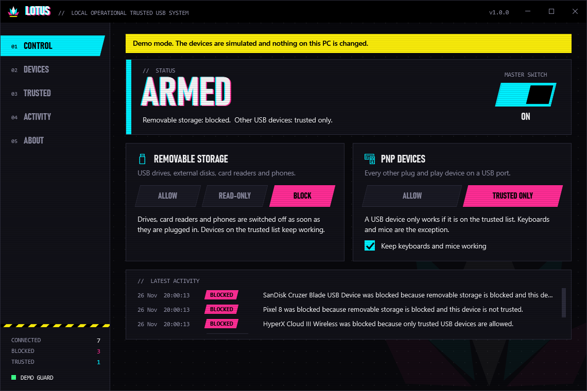
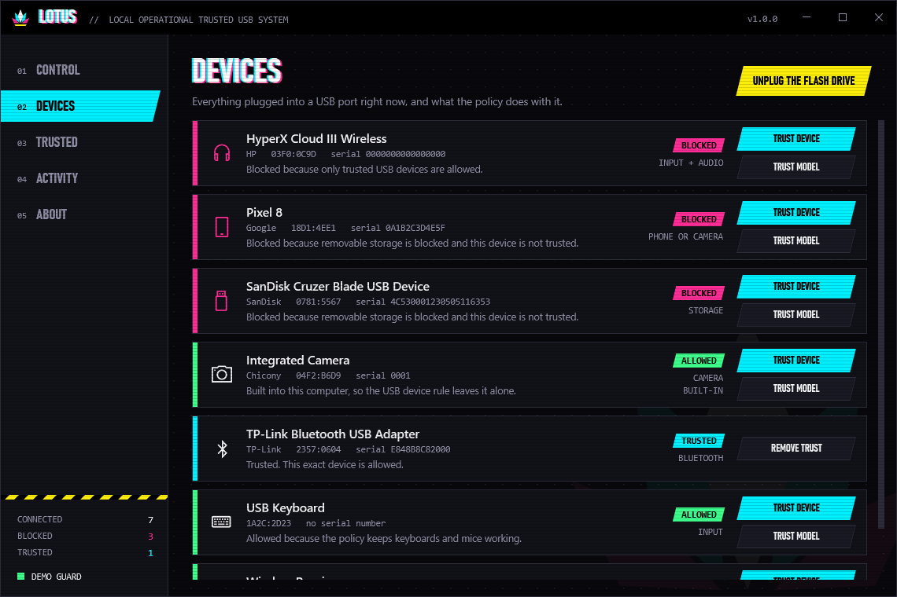
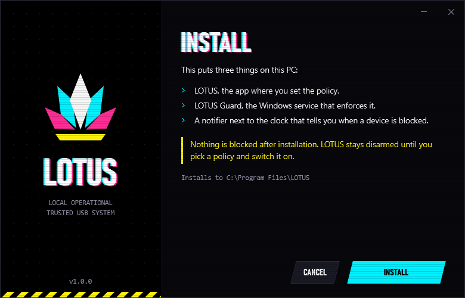
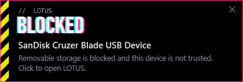

# LOTUS

Local Operational Trusted USB System. Offline device control for Windows.



LOTUS decides which USB devices are allowed to work on a Windows PC. You pick a policy in the app, a Windows service enforces it, and nothing ever leaves the machine: there is no server, no account and no telemetry.

It controls two things: removable storage, and every other plug and play (PnP) device on a USB port.

## What you can set

| Setting | Choices | What it covers |
| --- | --- | --- |
| Removable storage | Allow, Read-only, Block | USB drives, external disks, card readers, phones and cameras |
| PnP devices | Allow, Trusted only | Keyboards, mice, headsets, network and Bluetooth adapters, printers, hubs and anything else on USB |
| Trusted list | One device or a whole model | Devices on the list are never blocked |

A device you trust as "this device" is matched by its serial number. A device you trust as "whole model" is matched by vendor and product ID, so every unit of that model works.

LOTUS also keeps an activity log, and a small notifier next to the clock tells whoever is at the PC why the thing they just plugged in does nothing.



## Install

1. Download `LOTUS-Setup.exe` from the [releases page](https://github.com/MAXIVA11/LOTUS/releases), or build it yourself (see below).
2. Run it and accept the Windows administrator prompt.
3. Press Install, then Open LOTUS.

Nothing is blocked after installation. LOTUS stays disarmed until you choose a policy and switch it on.

The setup file is not code signed, so Windows SmartScreen may show "Windows protected your PC" the first time. Choose More info, then Run anyway. Each release lists the file's SHA-256 hash so you can check your download.

LOTUS runs on Windows 10 (version 1607 or newer) and Windows 11. It uses the .NET Framework 4.6.2 or newer that those versions already include, so there is no runtime to install.



## Your first policy

1. Open LOTUS. The status reads DISARMED.
2. Under Removable storage, choose Allow, Read-only or Block.
3. Under PnP devices, choose Allow or Trusted only.
4. Turn the master switch on and press Apply.

Before anything changes, LOTUS shows which connected devices the new policy would switch off. If you chose Trusted only, it offers to put the devices that are connected right now on the trusted list, so your own headset and adapters keep working.


To let a blocked device in later, plug it in, open the Devices page and press Trust device or Trust model. It starts working within a second or two.



"Keep keyboards and mice working" is on by default. With it on, any keyboard or mouse works even under Trusted only, so you can always reach LOTUS. Turn it off if you also want to stop devices that pose as keyboards and type on their own. Trust your own keyboard and mouse before you do.

## How blocking works

LOTUS Guard is a Windows service that runs as SYSTEM. Windows tells it the moment a device appears on a USB port. The service reads what the device says it is from its USB class codes, checks that against the policy, and switches a blocked device off with the same Windows call Device Manager uses for "Disable device".

The disabled state belongs to that device, and Windows remembers it. A blocked drive stays off when it is unplugged and plugged back in, after a restart, and while the service is stopped. Windows refuses to disable a keyboard while its driver is running, so LOTUS first removes the keyboard from the running system and then disables it.

LOTUS keeps a ledger of every device it switched off and only ever re-enables devices on that ledger. A device you disabled yourself in Device Manager stays disabled.

Read-only mode works differently. It sets the "Removable Storage Access" policy that is built into Windows, so the storage stack itself refuses the write. LOTUS restarts connected drives for a moment so the change reaches them.

The full description is in [docs/how-it-works.md](docs/how-it-works.md).

## Limits

- A device Windows has never seen can be active for a moment before it is switched off, usually well under a second. After that first time it comes back already disabled.
- Anyone with administrator rights on the PC can change the policy or stop the service. LOTUS guards against people and devices without those rights.
- LOTUS covers USB ports. It does not manage Bluetooth pairing, Thunderbolt docks, SATA ports or network shares.
- Read-only mode applies to every removable drive, trusted ones included, because Windows applies it to the whole class of device. It also covers CD and DVD writers.
- The disk Windows boots from is never blocked, even when it is a USB disk.
- Read-only mode has been checked up to the point where the Windows policy is written and removed. It has not yet been tried with a physical drive on the development PC. If it does not hold on your edition of Windows, please open an issue.

## The policy file

The policy is one small JSON file, `C:\ProgramData\LOTUS\policy.json`. Administrators can edit it by hand or copy it to other PCs. The service picks up a change within two seconds.

```json
{
  "version": 1,
  "armed": true,
  "storage": "block",
  "pnp": "block",
  "allowInput": true,
  "trusted": [
    {
      "kind": "device",
      "id": "USB\\VID_0781&PID_5567\\4C530001230505116353",
      "name": "SanDisk Cruzer Blade USB Device",
      "added": "2026-11-26T19:40:00Z"
    },
    {
      "kind": "model",
      "id": "VID_046D&PID_C542",
      "name": "Wireless Receiver",
      "added": "2026-11-26T19:40:00Z"
    }
  ]
}
```

`storage` is `allow`, `readonly` or `block`. `pnp` is `allow` or `block`. If the file is damaged, the service keeps the last policy it loaded and writes the reason to the activity log.

## Try it without installing

`LOTUS.exe --demo` opens the app with simulated devices and a simulated guard. Nothing on the PC is changed, and you can plug a pretend flash drive in and out to see blocking and the notification.

## If you lock yourself out

With "Keep keyboards and mice working" turned off, an untrusted keyboard or mouse is blocked like any other device. If you end up with no working input device:

1. Start Windows in Safe Mode. LOTUS Guard does not run there.
2. Use a keyboard LOTUS has not blocked. For most keyboards a different USB port is enough, because a keyboard without a serial number counts as a new device in each port.
3. Open an administrator command prompt and run `"C:\Program Files\LOTUS\LotusGuard.exe" --release-all`. This switches every blocked device back on.
4. Open LOTUS and fix the policy, or delete `C:\ProgramData\LOTUS\policy.json` to start again disarmed.

## Uninstall

Use "Installed apps" in Windows Settings, or run `"C:\Program Files\LOTUS\Uninstall.exe"`. The uninstaller switches every blocked device back on, lifts read-only mode, and removes the service, the program files, the policy and the log.

## Build from source

You need Windows and the .NET SDK 8 or newer.

```powershell
git clone https://github.com/MAXIVA11/LOTUS.git
```

```powershell
powershell -ExecutionPolicy Bypass -File LOTUS\build.ps1
```

The result is `dist\LOTUS-Setup.exe`. The script builds the app and the service, runs the unit tests, packs both into the setup program and prints its SHA-256 hash.

| Folder | Contents |
| --- | --- |
| `src/Lotus.Core` | Policy model, the decision engine, USB scanning and device control |
| `src/Lotus.Guard` | `LotusGuard.exe`, the Windows service |
| `src/Lotus.App` | `LOTUS.exe`, the app and the notifier |
| `src/Lotus.Setup` | `LOTUS-Setup.exe`, the installer and uninstaller |
| `tests/Lotus.Tests` | Unit tests for the engine and the enforcement loop |
| `tests/Lotus.Probe` | A small developer tool that runs single device calls, used by the hardware scripts |
| `tests/hardware` | Scripts that test device control and a full install on real hardware |
| `tools` | The script that draws the icon |

## Tests

`dotnet test tests\Lotus.Tests` runs the unit tests. They cover the policy engine and run the enforcement loop against a simulated USB bus that behaves the way Windows was observed to behave.

The scripts in `tests\hardware` need an administrator prompt and real devices. `probe-block.ps1` blocks and unblocks single devices. `e2e-install.ps1` installs LOTUS with the real setup, arms a policy, checks that one chosen device is blocked and released, restarts the service, switches read-only mode on and off, and uninstalls again. Read the comments at the top of each script before running it.

## About the look

The interface borrows from the hacker style of Watch Dogs 2: neon on black, hazard stripes and glitching type. LOTUS is an independent project and is not affiliated with Ubisoft.

## License

MIT. See [LICENSE](LICENSE).
