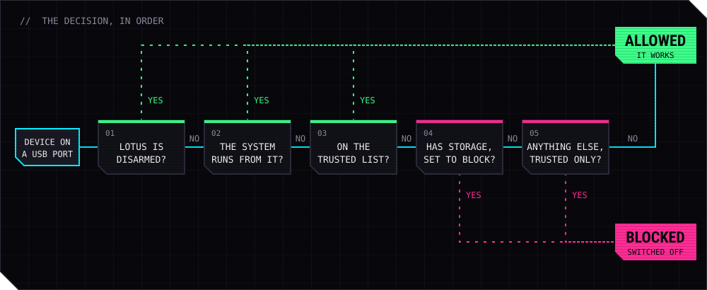

# How LOTUS works

This page describes the Windows version. What counts as one device, how trust works and the order of the decision are the same on Linux, because both versions run the same engine. How devices are read and switched there is in [linux.md](linux.md).

## The parts

| Program | Runs as | Job |
| --- | --- | --- |
| `LotusGuard.exe` | Windows service, SYSTEM | Watches USB ports, enforces the policy, owns the policy store |
| `LOTUS.exe` | Administrator | The window where you set the policy and trust devices |
| `LOTUS.exe --tray` | The signed-in user | Shows a notification when a device is blocked |
| `Lotus.Core.dll` | Loaded by all of the above | The policy engine and the Windows device calls |

The service is the only program that reads or writes the policy. The app asks the service for the policy and sends changes to it over a local named pipe, `\\.\pipe\LotusGuard.Control`. The pipe accepts elevated administrators on this PC only, and the app checks that the process on the other end really is the LotusGuard service before it sends anything.

Files live in `C:\ProgramData\LOTUS`:

| File | Who can read it | Purpose |
| --- | --- | --- |
| `events.jsonl` | Everyone | The activity log, one line per event |
| `status.json` | Everyone | Whether LOTUS is armed, for the notifier |
| `secure\policy.dat` | The service only | The policy and the trusted list, encrypted |
| `secure\ledger.dat` | The service only | The devices LOTUS itself switched off, encrypted |
| `secure\seal.key` | The service only | The key both files are encrypted with |

Only the service can write to any of them. [security.md](security.md) describes the encrypted files.

The service also writes every line of the activity log to the Windows event log, where log collectors can pick it up. [logging.md](logging.md) has the event numbers.

## What counts as one device

LOTUS decides per physical device: the thing on one USB port. A headset with an audio interface and a button interface is one device. A hub is one device, and whatever is plugged into the hub is judged separately. The same goes for a Bluetooth adapter: the phones and keyboards paired with it sit on another bus and are not part of the adapter.

Windows gives every device an instance ID such as `USB\VID_0781&PID_5567\4C530001230505116353`. The last part is the serial number the device reports. A device without a serial number gets a generated ID that depends on the port, for example `USB\VID_1A2C&PID_2D23\5&CC3F949&0&6`. That is why LOTUS offers two kinds of trust:

- "This device" stores the full instance ID. It follows a device with a serial number to any port. For a device without one, it only holds in the port where you trusted it.
- "Whole model" stores `VID_xxxx&PID_xxxx` and covers every unit of that model in any port.
- "Whole vendor" stores `VID_xxxx` and covers every device that reports that vendor.

The first two are made from a device that is plugged in, on the Devices page. All three can also be typed in on the Trusted page, for a device that is not there: a vendor ID, a vendor and product ID, or an instance path.

A trust entry also records which USB functions the device had when you trusted it. If the device later shows up with a function that is not on that list, the entry no longer covers it and the policy applies as if it were not trusted. A trusted headset that suddenly presents a keyboard or a disk is blocked. Showing fewer functions than before is fine.

An entry that was typed in has no such record, and neither has an entry for a whole vendor: LOTUS has not seen the device. It covers the device whatever it does.

## Working out what a device does

LOTUS reads a device's configuration descriptor straight from the hub it is plugged into (`IOCTL_USB_GET_DESCRIPTOR_FROM_NODE_CONNECTION`). The descriptor lists every interface with its USB class code. This works the moment the device is on the bus, before Windows has loaded a driver, so LOTUS does not have to wait for Windows to list the functions.

It also reads the compatible IDs the bus driver publishes and the setup class of the drivers Windows loaded. Everything found either way counts:

| Kind | Comes from |
| --- | --- |
| Storage | USB class 08, or a disk or optical drive below the device |
| Phone or camera | USB class 06, the MTP marker, or a portable device driver |
| Input | USB class 03 |
| Audio, camera, network, Bluetooth, printer, smart card, hub | Their USB class codes |
| Other | Vendor specific classes and anything unrecognised |

The storage setting applies to the first two kinds. The PnP setting applies to everything else a device does. A flash drive that also presents a keyboard is both, and either rule can block it.

If the descriptor cannot be read, LOTUS falls back to waiting up to three seconds for Windows to list the interfaces. With both rules set to block and no exception for keyboards, there is nothing to wait for and the device is blocked at once.

## The decision



For each device, in this order:

1. LOTUS is disarmed: allow.
2. The system runs from a disk behind this device: allow.
3. The device is on the trusted list, and does nothing it did not do when it was trusted: allow.
4. It has storage and storage is set to Block: block.
5. PnP devices are set to Trusted only and the device does something besides storage:
   - Windows reports it as built into the computer and its port is not one you can plug things into (a laptop webcam, for example): allow.
   - "Keep keyboards and mice working" is on and everything else it does is input: allow.
   - Otherwise: block.
6. Allow.

The same function runs in the service, in the app (to show what would happen before you apply a change) and in the unit tests.

## Timing

How long a blocked device can be active depends on whether this PC has seen it before, and on strict mode.

A device LOTUS has blocked before does not start at all. The disabled mark is stored with the device, and Windows reads it before it loads a driver. In the hardware test a blocked device was taken off the bus and put back by resetting its port, and Windows logged no start for it or for any of its functions.

Devices this PC has seen before, and that the policy blocks on sight, get the same mark while they are unplugged. The marks are made when the policy changes and are taken back when the policy stops blocking those devices.

A device Windows has never seen has no record to mark. What happens to it depends on strict mode.

With strict mode on, Windows itself refuses to install the device. Strict mode is the "Refuse new devices before they start" box, which is not ticked after installation. LOTUS has told Windows to refuse every USB class the policy blocks, through the device installation restrictions that are part of Windows. Windows checks them before it loads any driver, logs "configuration blocked by policy", and the device never starts. In the hardware test neither the device nor any of its functions was started.

A new device the policy allows is refused in the same way at first, because Windows only knows the deny list and a list of exceptions. LOTUS reads the device's descriptors, sees that the policy allows it and adds it to the exceptions at once. Windows is still busy with the device at that moment, and its next step installs it. On the test PC a device with one function was running 60 milliseconds after Windows had refused it, and a device with two functions, each of which Windows refuses and LOTUS lets in separately, 170 milliseconds after.

If the exception comes too late for that, LOTUS waits a second for Windows to finish, then has it forget the device and find it again, which installs it. LOTUS does not do this earlier, because an installation attempt that is still running would mark the new device as failed.

With strict mode off, Windows installs and starts the new device and notifies the service as soon as the device exists. The service judges that one device right away, from its descriptors, without scanning the others, and switches it off. Windows finishes starting the device before it carries out the request. On the test PC the device ran for 5 to 7 milliseconds, and in one of the runs its HID function came up for about a millisecond before the whole device went off.

A full pass over all devices follows 40 milliseconds after any change and every two seconds after that.

## Switching a device off

The service calls `CM_Disable_DevNode` with the persist flag. That is the call behind "Disable device" in Device Manager. Windows stops the device's drivers and stores a disabled mark with the device, so it comes back disabled after replugging and after a restart, whether or not the service is running at that time.

Windows refuses to disable a device while a keyboard driver is running on it. For those, the service first calls `CM_Query_And_Remove_SubTree`, which unloads the drivers, and then disables the device.

Before it touches a device, the service writes the device to its ledger. If the service is stopped in the middle of an operation, the next run still knows the device is its responsibility.

## Switching a device back on

When the policy stops blocking a device on the ledger, because you trusted it, changed a setting or disarmed LOTUS, the service enables it again and removes it from the ledger. If the device is not plugged in at that moment, the service clears the disabled mark Windows keeps for it, so it works the next time it is connected.

LOTUS never enables a device that is not on its ledger. Something you disabled by hand in Device Manager stays disabled.

## Read-only mode

Read-only mode writes `Deny_Write = 1` under `HKLM\SOFTWARE\Policies\Microsoft\Windows\RemovableStorageDevices` for removable disks, CD and DVD drives, floppy drives and portable devices. This is the registry form of the Group Policy setting "Removable Storage Access", and Windows enforces it inside the storage stack.

Windows applies the setting when a drive is connected, so the service switches connected drives off and on again when the mode changes.

The service checks the registry values every two seconds and puts them back if they are removed. It only removes values it set itself.

## Safety rules

- The disk Windows boots from is never blocked. If the service cannot work out which disk that is, it leaves all storage alone until it can.
- A failed block or release is retried and reported once in the activity log.
- Uninstalling switches every device on the ledger back on, removes the read-only setting and the installation restrictions, and has Windows install what it had refused, before any file is deleted.
- LOTUS only removes installation restrictions it set itself. If the PC already has some from an administrator or Group Policy, strict mode stays off and LOTUS says so in the activity log.
- Names and serial numbers come from the device, so they are cleaned before they are logged or shown: control characters, invisible characters and characters that reorder text are removed, and long names are cut.

How LOTUS protects its own policy and service is described in [security.md](security.md).

## Command line

```
LotusGuard --scan          List USB devices and what the current policy says about each,
                           as JSON: the version, whether LOTUS is armed or locked down,
                           when it was last tampered with, and every device with its state.
                           Asks the running service for the policy. Monitoring tools can
                           use it, or read status.json, which needs no rights.
LotusGuard --console       Enforce the policy from a console window until Enter is pressed.
LotusGuard --release-all   Disarm LOTUS, switch every blocked device back on, lift read-only
                           mode and remove the installation restrictions. Works without
                           the service too, for example in Safe Mode.

LOTUS --demo               Open the app with simulated devices.
LOTUS --tray               Run the notifier.

LotusGuard --trust-connected
                           Put every USB device that is connected right now on the trusted list.

LOTUS-Setup /quiet                 Install or update without a window.
LOTUS-Setup /quiet /trust-connected
                                   The same, and on a new installation put the connected
                                   devices on the trusted list.
LOTUS-Setup /uninstall /quiet      Remove without a window.
```

Quiet setup returns 0 on success, 1 on failure and 2 when it finished with warnings. Setup writes its progress to `setup.log` in the install folder.
