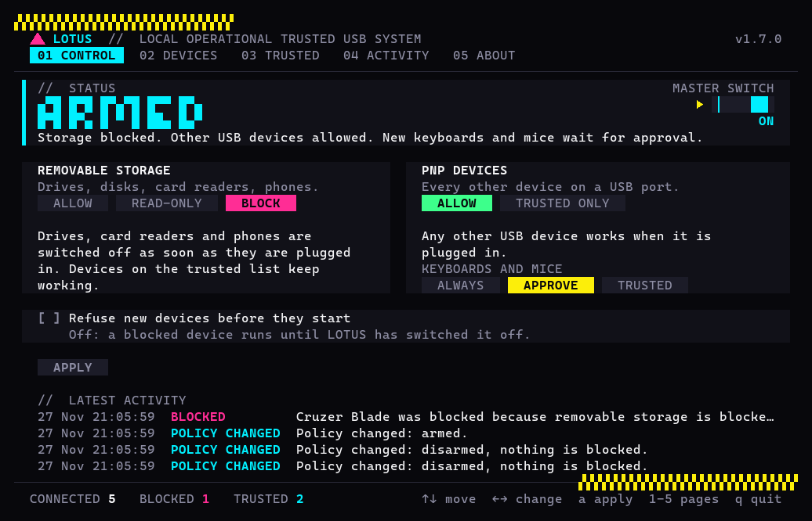
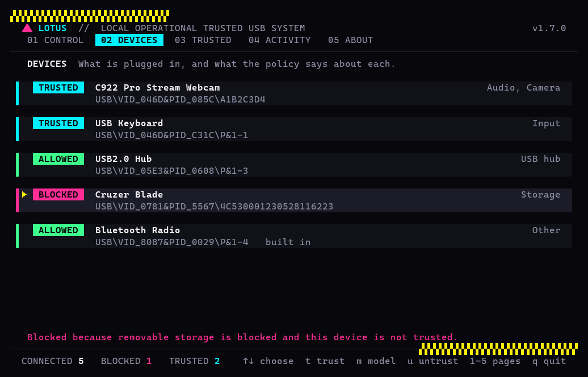

# LOTUS on Linux

LOTUS for Linux is a daemon and a command, `lotus`. The rules are the ones the Windows version has, decided by the same code: removable storage can be allowed, read-only or blocked, every other USB device can be allowed or limited to a trusted list, and the policy sits in the same encrypted store.

There is no window. `sudo lotus` opens an interactive interface in the terminal, with the pages the Windows app has, and every setting is also a command for scripts.

## What it needs

- A 64-bit Intel or AMD computer.
- A Linux that uses systemd.
- No runtime to install. The program is one file that carries its own.

LOTUS for Linux is tested on Ubuntu 24.04 with kernel 6.8, in a virtual machine with USB devices emulated by QEMU. It has not been run against physical USB hardware. See [How it is tested](#how-it-is-tested).

## Install

Download `lotus-<version>-linux-x64.tar.gz` from the [releases page](https://github.com/MAXIVA11/LOTUS/releases). Then:

```sh
tar -xzf lotus-*-linux-x64.tar.gz
cd lotus-*-linux-x64
sudo ./install.sh
```

The installer copies the program to `/usr/local/bin/lotus`, adds the service `lotus.service` and starts it. Nothing is blocked afterwards. LOTUS stays disarmed until you choose a policy and arm it.

On a new installation the installer asks whether the USB devices that are connected right now should go on the trusted list. The answer is no unless you say yes. `sudo ./install.sh --trust-connected` answers yes in advance and `--no-trust` answers no. Without a terminal nobody is asked.

A new installation starts disarmed, with storage and every other device allowed, keyboards and mice always working, strict mode off and an empty trusted list.

Running `install.sh` from a newer release updates LOTUS and keeps your policy.

## The interactive interface

```sh
sudo lotus
```

<p align="center">
  
</p>

Run on its own at a terminal, `lotus` opens five pages: Control, Devices, Trusted, Activity and About. They hold what the pages of the Windows app hold, and work the same way: you change the settings, press Apply, and LOTUS lists the connected devices the new policy would switch off before anything happens.

| Key | What it does |
| --- | --- |
| <kbd>1</kbd> to <kbd>5</kbd>, <kbd>Tab</kbd> | Change the page |
| <kbd>↑</kbd> <kbd>↓</kbd> | Move between the settings, or through a list |
| <kbd>←</kbd> <kbd>→</kbd>, <kbd>Space</kbd> | Change the setting that is marked |
| <kbd>a</kbd> | Apply the changes on the Control page |
| <kbd>t</kbd>, <kbd>m</kbd>, <kbd>u</kbd> | On Devices: trust the device, trust its model, take the trust away |
| <kbd>n</kbd>, <kbd>e</kbd>, <kbd>x</kbd> | On Trusted: add an entry by hand, give the entry an end, remove the entry |
| <kbd>Esc</kbd> | Close a dialog, or drop changes that were not applied |
| <kbd>q</kbd> | Leave |

The keys of the page you are on are always shown at the bottom right.

<p align="center">
  
</p>

A question that could switch off something that works, such as applying a stricter policy or removing trust, starts with the safe answer selected. The interface needs a terminal of at least 80 columns by 24 rows. On the plain Linux console, which cannot show block characters, it draws with ordinary letters and signs.

In a script or a pipe, `lotus` on its own prints the status, and the commands below do the rest.

## Your first policy

In the interface: open `sudo lotus`, choose the two rules with the arrow keys, switch the master switch on and press <kbd>a</kbd>. The same with commands follows here.

See what is connected:

```sh
sudo lotus devices
```

Choose the rules. For example, block USB storage and let only trusted devices work:

```sh
sudo lotus storage block
sudo lotus usb trusted
```

Trust your own devices by the number or the ID that `lotus devices` shows:

```sh
sudo lotus trust 3
```

Then start enforcing:

```sh
sudo lotus arm
```

A change that would switch off a device that works right now lists those devices and asks first. Nothing happens unless you answer yes. In a script, add `--yes`.

## Commands

| Command | What it does |
| --- | --- |
| `lotus` | Open the interactive interface |
| `lotus status` | What is in force right now |
| `lotus status --json` | The same as one JSON object, for monitoring tools |
| `lotus devices` | The connected USB devices and what the policy says about each |
| `lotus log [lines]` | The activity log |
| `lotus storage allow\|readonly\|block` | USB drives, card readers, cameras and phones |
| `lotus usb allow\|trusted` | Every other USB device: all of them, or only trusted ones |
| `lotus input on\|approve\|off` | Keyboards and mice: always work, wait for approval when new, or need trust like any other device. `on` after installation |
| `lotus strict on\|off` | Hold new devices back before they start. Off after installation |
| `lotus arm`, `lotus disarm` | Start and stop enforcing |
| `lotus trust <number\|id>` | Trust one device that is plugged in |
| `lotus trust <number\|id> --model` | Trust every unit of that model |
| `lotus trust connected` | Trust every device that is plugged in right now |
| `lotus trust vendor <vid>` | Trust every device of a vendor, for example `046D` |
| `lotus trust model <vid:pid>` | Trust every unit of a model, for example `046D:C52B` |
| `lotus trust id <instance path>` | Trust one device by its path, plugged in or not |
| `lotus trust ... --for 7d` | Trust that ends by itself after a length of time: `90m`, `12h`, `7d`, `2w` |
| `lotus trust ... --until 2026-12-04` | Trust that ends on a date, with a time if you like: `"2026-12-04 17:00"` |
| `lotus trusted` | The trusted list |
| `lotus untrust <number\|id\|model\|vendor>` | Take an entry off the trusted list |
| `lotus release-all` | Disarm and switch every blocked device back on |
| `lotus version` | The version |

Every command except `version` and `help` needs root, because only root may talk to the daemon.

The three `trust` commands that take a typed value are for a device that need not be plugged in. Add `--name "..."` to give the entry a name. An entry made this way covers the device whatever it does, because LOTUS has not seen it, and a whole vendor also lets in devices you have never seen.

`lotus input approve` makes a new keyboard, mouse or other input device wait until you trust it, whatever `lotus usb` is set to. That stops a device that poses as a keyboard and types on its own. The ones that work at that moment are put on the trusted list in the same step, and `--no-trust` leaves them out. A waiting device shows as PENDING in `lotus devices`, and `lotus trust <number>` approves it. If no keyboard and no mouse works at all, the daemon lets one waiting device in after 15 seconds and marks it NOT APPROVED. The [README](../README.md#keyboards-and-mice) has the details.

`--for` and `--until` work with every `trust` command. A date without a time means the end of that day by the computer's clock. When the time is up, the daemon takes the entry off the list, switches the device off if the policy blocks it, and writes "trust ended" to the log. Given for an entry that is on the list already, they change its end, and `--for never` takes the end away. `lotus trusted` shows the end of every entry that has one.

`lotus status --json` is for monitoring tools. It prints one object with the fields `version`, `running`, `armed`, `lockdown`, `storage`, `usb`, `keepInput`, `strict`, `strictState`, `trusted`, `trustedWithEnd`, `connected`, `blocked`, `lastTamper` and `heldAtStart`. The names stay the same from version to version. When the daemon does not answer, it still prints JSON, with `running` false and the reason in `error`, and ends with exit code 1.

The daemon also writes every line of the activity log to the systemd journal. [logging.md](logging.md) has the fields and the event numbers.

## How blocking works on Linux

The kernel has a switch for every USB device: the file `authorized` in the device's folder under `/sys/bus/usb/devices`. While it holds 0 the device has no configuration. No driver is bound to it, and none of its functions exist: a stick has no disk, a keyboard types nothing. LOTUS blocks a device by writing 0 there and lets it back in by writing 1.

The kernel reads a device's descriptors before it asks whether the device is authorized, and keeps them readable. So LOTUS knows what a device is, down to every function in every configuration it offers, without letting it run.

Strict mode uses a second switch. Each USB controller has a file `authorized_default`. While it holds 0, the kernel does not switch on anything that is plugged into that controller. It reads the descriptors and waits. With strict mode on and LOTUS armed, LOTUS sets every controller to 0 and switches on the devices the policy allows, one by one. A device the policy blocks never runs. The kernel log then has the line "Device is not authorized for usage" for it and nothing from any driver.

A device the policy allows is held back in the same way at first and switched on as soon as LOTUS has read what it is. In the test machine a new mouse was running 44 to 48 milliseconds after the kernel had held it back.

LOTUS hears about new devices from the kernel itself, over a netlink socket. It takes such a message as a reason to look, and decides from what it then reads under `/sys`.

Read-only mode is a udev rule, `/etc/udev/rules.d/99-lotus-readonly.rules`. It marks every USB disk as read-only in the kernel the moment the disk appears, before the desktop can mount it. The kernel then refuses writes whatever a mount command asks for. When the mode changes, LOTUS switches connected disks off and on once so that they appear again under the new rule.

LOTUS keeps a ledger of the devices it switched off. When the policy stops blocking one of them, that is the device it switches back on.

### Before the daemon starts

The kernel forgets its USB switches when the computer restarts, and the daemon starts some seconds after the kernel. In that time the kernel runs every device that is plugged in. A device that sits in a port when the computer is switched on gets those seconds, whatever the policy says.

The kernel can close that gap itself. Started with `usbcore.authorized_default=2` on its command line, it switches on only the devices its firmware tables mark as built in, and leaves every other one waiting from the first moment. LOTUS notices the setting when the daemon starts, and takes over:

- a waiting device the policy blocks goes on the list of blocked devices without ever having run
- a waiting device the policy allows is switched on
- with strict mode off, the controllers are opened again for what is plugged in later, and with strict mode on they stay shut as usual

On Debian and Ubuntu, which start with GRUB:

```sh
echo 'GRUB_CMDLINE_LINUX_DEFAULT="$GRUB_CMDLINE_LINUX_DEFAULT usbcore.authorized_default=2"' | sudo tee /etc/default/grub.d/99-lotus.cfg
sudo update-grub
```

After the next restart, `cat /sys/module/usbcore/parameters/authorized_default` prints 2 and `lotus status` has the line "AT START: DEVICES WAIT FOR LOTUS". To undo it, delete the file and run `sudo update-grub` again.

Other systems have their own way of adding a kernel parameter. On Fedora and RHEL that is `sudo grubby --update-kernel=ALL --args=usbcore.authorized_default=2`. This has only been tested on Ubuntu 24.04.

> [!WARNING]
> With this setting, nothing but the LOTUS daemon switches on a USB device that is not built in. On a desktop computer that includes the keyboard and the mouse. Before you set it, read these.
>
> - If the daemon cannot start, those devices stay off. Restart, and at the boot menu, where the keyboard works because the firmware drives it, edit the kernel line and delete `usbcore.authorized_default=2`.
> - Take the setting off before you uninstall LOTUS, or right after. The uninstaller reminds you.
> - Do not use it on a computer that starts from a USB disk. The kernel would hold back the disk it is starting from.

### The disk the system runs from

A Linux that is installed on a USB disk, or runs live from a stick, depends on that disk. LOTUS works out which USB devices hold the system's own filesystems, also through encrypted and logical volumes, and never switches them off, nor a hub on the way to them. The read-only rule names that disk as an exception, so it stays writable.

If LOTUS cannot work out which disk the system runs from, it leaves every storage device alone and does not switch read-only mode on.

### What counts as storage

The storage rule covers mass storage devices (USB class 08), which is every stick, external disk and card reader, and devices of the still image class (06), which is how cameras and current phones offer their files. Some older phones and players speak MTP over a vendor specific interface instead. LOTUS recognises those by the shape MTP requires, an interface with subclass FF, protocol 00 and one bulk endpoint in each direction plus an interrupt endpoint, and treats them as phones too.

### How a device is named

LOTUS gives every device an ID in the form the Windows version uses: `USB\VID_0781&PID_5567\4C530001230505116353`. The last part is the device's serial number. A device without one is named by its port instead, for example `USB\VID_046D&PID_C31C\P&1-2`, so trusting it holds for that port.

A port the kernel reports as fixed, which is how a laptop's webcam or Bluetooth radio is wired, makes the device count as built in. The "trusted only" rule leaves built-in devices alone.

### Hubs

A hub is a device like any other, and under "trusted only" an untrusted hub is switched off. Nothing that is plugged into a hub that is off exists for the system, so trust the hub first. Whatever is behind a trusted hub is still judged on its own.

`lotus` tells you when a change would take a hub down together with the devices behind it.

## Where the files are

| Path | Purpose |
| --- | --- |
| `/usr/local/bin/lotus` | The program: daemon and command in one |
| `/usr/local/sbin/lotus-uninstall` | The uninstaller |
| `/etc/systemd/system/lotus.service` | The service |
| `/var/lib/lotus/secure/policy.dat` | The policy and the trusted list, encrypted |
| `/var/lib/lotus/secure/ledger.dat` | The devices LOTUS switched off, encrypted |
| `/var/lib/lotus/secure/seal.key` | The key both files are encrypted with |
| `/var/lib/lotus/events.jsonl` | The activity log |
| `/run/lotus/control.sock` | The socket the `lotus` command talks to the daemon on |

`/var/lib/lotus` and `/run/lotus`, and everything in them, belong to root and are closed to everyone else.

## Protection

The store has the same format as on Windows: AES-256 with HMAC-SHA256, in a binary container. Someone who gets hold of `policy.dat` without the key cannot read it or change it unnoticed. If the file is changed, replaced or deleted while the daemon runs, the daemon puts its own copy back and writes a "tamper" line to the log. If the store is wrecked while the daemon is down, LOTUS locks down: it blocks storage and every untrusted device until `install.sh` is run again, which resets it to an empty policy.

Linux has no counterpart to the Windows data protection service, so the key is an ordinary file that only root can read. The encryption keeps the policy from everyone who is not root. Root can read the key.

The control socket is a Unix socket with mode 0600, and the daemon also asks the kernel who is on the other end of each connection and turns away anyone who is not root.

The daemon runs as root with no capabilities at all, a read-only view of the system apart from its own folders and the udev rules folder, no network, and no access to home directories. The service file has the full list.

## Limits

These come on top of the [limits that apply everywhere](../README.md#limits).

- Root can do anything LOTUS can do, and undo it. LOTUS on Linux protects a computer from the devices plugged into it and from users who are not root.
- Stopping the daemon opens nothing: blocked devices stay off and the controllers stay shut. But a restart of the computer resets the kernel's switches. From power-on until the daemon starts, the kernel runs every device that is plugged in. The daemon then switches off what the policy blocks. A kernel setting closes this gap, with a risk of its own: see [Before the daemon starts](#before-the-daemon-starts).
- With strict mode off, which is how LOTUS starts, a blocked device that is plugged in runs until the daemon has switched it off.
- If another program already holds the USB controllers shut, as USBGuard does, LOTUS does not touch them, and strict mode is off. It still switches blocked devices off after they start.
- The kernel shows a device that is off in one way only, whoever switched it off. With strict mode on, LOTUS takes a device that is off and not on its ledger for one the kernel is holding back, and switches it on if the policy allows it. A device you switch off by hand through its `authorized` file does not stay off unless the policy blocks it.
- Read-only mode covers disks. A phone or camera that speaks MTP or PTP has no disk for the kernel to protect, so read-only mode does not make it read-only. Set storage to `block` to keep such devices out.
- There is no notification on the desktop when a device is blocked. `lotus log` shows what happened.
- LOTUS covers USB. It does not manage Thunderbolt, Bluetooth pairing, SATA ports or network shares.

## If you lock yourself out

With `lotus input off` and `lotus usb trusted`, an untrusted keyboard is blocked like any other device, and nothing lets one in. `lotus input approve` has a safety net and cannot do this.

- A laptop's own keyboard is usually not a USB device and keeps working.
- Over the network nothing changes: `ssh` in and run `sudo lotus release-all`.
- Otherwise restart the computer and start it in rescue mode: at the boot menu, add `systemd.unit=rescue.target` to the kernel line. The daemon does not run there, and after a restart the kernel has every device switched on. Then run `systemctl start lotus` and `lotus release-all`, or remove LOTUS with `lotus-uninstall`.
- If the kernel is started with `usbcore.authorized_default=2`, delete that from the kernel line in the same step. Otherwise the kernel holds the keyboard back in rescue mode too.

## Uninstall

```sh
sudo lotus-uninstall
```

The daemon switches every blocked device back on, opens the controllers, lifts read-only mode and erases the policy. Then the service, the program, the folders and the uninstaller itself are removed. If the daemon cannot be reached, the uninstaller opens the controllers and switches the devices on by itself.

## Build from source

You need Linux and the .NET SDK 8 or newer.

```sh
git clone https://github.com/MAXIVA11/LOTUS.git
cd LOTUS
./build-linux.sh
```

The result is `dist/lotus-<version>-linux-x64.tar.gz`. The script runs the unit tests first.

To try LOTUS without touching the system, run the daemon in developer mode against a device tree of your own making:

```sh
lotus --dev --sysfs ./fake-sys --state ./state --socket ./lotus.sock daemon
lotus --sysfs ./fake-sys --state ./state --socket ./lotus.sock status
```

## How it is tested

`tests/Lotus.Linux.Tests` holds the unit tests. The tests of the shared core run there against the Linux build, and the Linux parts are tested on a made-up device tree: reading devices, the controller switch, the read-only rule, the socket, the whole daemon from arming to removal, and every page and dialog of the interactive interface.

`tests/linux/vm-test.sh` tests on a real kernel. It boots Ubuntu 24.04 under QEMU, once from an ordinary disk and once from an emulated USB disk, installs LOTUS from the release folder the way a user would, and plugs emulated devices into the machine's USB controller: three sticks, two keyboards, a mouse, a phone, a network adapter, a sound card, a smart card reader, a serial adapter and a hub. After each step it asks the kernel in the machine what happened. It checks, among other things, that:

- a blocked stick loses its disk, and a new stick under strict mode never gets a driver
- a new device the policy allows is switched on
- a phone counts as storage, and a network adapter, a sound card and a card reader are switched off under "trusted only"
- trust follows a stick to another port and does not cover a second stick of the same model
- nothing behind an untrusted hub exists, and a stick behind a trusted hub is still blocked
- read-only disks refuse writes, also a disk that is plugged in later
- the policy survives a killed daemon and a restart of the computer
- a damaged store locks LOTUS down and the installer resets it
- removal leaves no file and no device switched off
- the interactive interface arms LOTUS, trusts and untrusts a stick and adds a vendor by hand against the real daemon, and on a pseudo terminal it starts, reacts to keys and hands the terminal back
- trust given for a minute ends by itself: the stick is switched off, the entry is gone, and the log and the journal say so
- with new keyboards waiting for approval, a second keyboard never runs while every other device is allowed, and approving it switches it on
- with the machine's own keyboard taken away and no trusted one left, one keyboard is let in after a while and marked, and it waits again once an approved mouse works
- the journal has the daemon's lines with their event numbers, and `lotus status --json` says what is in force
- restarted with `usbcore.authorized_default=2`, the kernel holds every device back, LOTUS switches on the ones the policy allows, and a stick it has never seen and the policy blocks never runs, with strict mode off and with it on
- a machine that itself starts from a USB disk keeps that disk: it is not switched off under any rule, it stays writable in read-only mode, and the machine starts again with read-only mode on

CI runs both on every change.

The test does not cover physical hardware. The devices in it are emulated, while the kernel and everything above it are real. Timing on real ports, devices that misbehave electrically and controllers other than xHCI have not been tested.
